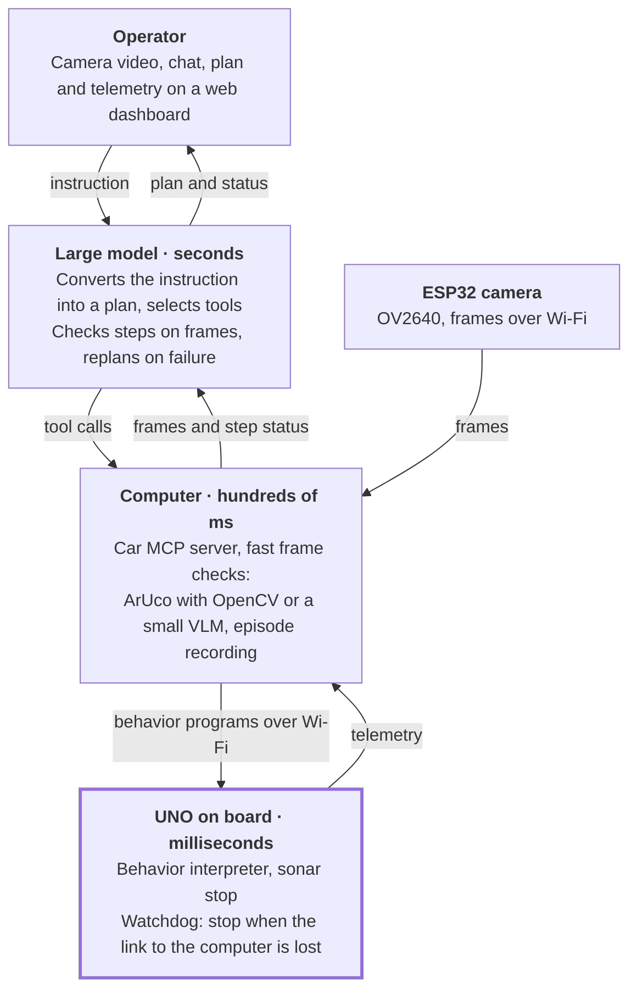

# LLM agent for the Elegoo robot car

An agent drives the Elegoo robot car from a natural-language instruction. It checks each step with the camera and the sensors. The operator watches the car video on a monitor and gives a task, for example: "drive to the red box and turn to face the door".

At start, the agent calibrates the car. Then it converts the instruction into a plan, executes the steps through a safe set of actions, and makes a new plan when a step fails.

**Research question:** can a small fine-tuned model on a narrow task reach the success rate of a frontier model, with a much lower decision latency? The project compares three "brains":

- a proprietary frontier model through an API;
- an open model that runs locally;
- a small fast model, fine-tuned on data from the project's own runs.

## Hardware and the main constraint

The UNO cannot execute new code at run time; a code change needs a new flash. Thus "code for the car" has three levels, and fast reactions run on board.

Kit: [Smart Robot Car Kit V4.0 with camera](https://www.elegoo.com/products/elegoo-smart-robot-car-kit-v-4-0), per the [listing specification](https://www.desertcart.lk/products/128067046-elegoo-uno-project-smart-robot-car-kit):

| Component | Part | Role in the project |
| --- | --- | --- |
| Controller | Elegoo UNO R3 | Executes behaviors, fast loop |
| Motors | 4 × 1:48 motors, TB6612 driver | Motion; calibration removes left/right asymmetry |
| Range sensor | Ultrasonic | Emergency stop, distance check |
| Line sensors | IR | Optional: track marks for tests |
| Camera | OV2640, up to 1024×768, on ESP32-WROVER | Video for the operator and the model |
| Link | Wi-Fi through ESP32, UART to UNO | Commands and telemetry |
| Pan mount | SG90, horizontal only, 0–180° | Scene scan without a body turn |
| Battery | 7.4 V, approx. 2 h in line mode | Limits the length of a run series |

Three levels of "code for the car":

1. **MVP.** The agent runs on the computer and sends simple commands over Wi-Fi.
2. **Behavior interpreter in the firmware.** The agent sends programs such as "drive while the obstacle is more than 20 cm away, max 3 s". The car reacts on board, without the model. This solves the real-time problem.
3. **Optional: generated firmware.** The agent writes C++, compiles it, and flashes it with arduino-cli. Slow, but a good demo.

The project replaces the factory firmware: a command protocol for the agent is easier to design from zero.

## Prerequisites

- [arduino-cli](https://arduino.github.io/arduino-cli/): `brew install arduino-cli`. The first `make upload` downloads the board core and the libraries that `firmware/car/sketch.yaml` sets.
- [uv](https://docs.astral.sh/uv/): `brew install uv`.

Set up Python: `make init install`. Lint and type check: `make lint`.

Hardware test after a firmware change: [docs/hardware-test.md](docs/hardware-test.md).

## Architecture: three loops

The agent has three loops with different speeds. The model is not in the fast loop.

Down arrows are commands; up arrows are observations.

The model plans and checks the steps at checkpoints. In front of an obstacle, the car stops by itself in milliseconds. Thus API latency makes a task slower, but not dangerous.

## Auto-calibration at start

Before the first task, the agent runs a short series of tests and saves a calibration profile. Reference: an ArUco marker on the wall. The camera finds the car position from it.

| Test | Measurement | Result |
| --- | --- | --- |
| Drive straight 1–2 s | Heading drift against the marker | Power correction for left and right side |
| Turn in place | Angle in a given time | Turn rate, °/s |
| Sonar at a wall | Reading against a known distance | Range sensor offset and noise, cm |
| Pan servo | Marker position in the frame | Camera center and turn limits |
| Video | Monitor timer, filmed by the camera | Frame latency, ms |

The planner uses the profile to convert "turn 90°" into a duration and a power. Speed decreases as the battery discharges. Thus, repeat the calibration at the start of each run series.

## Model comparison and evaluation

Main result: a "model × metric" table on one task set. Live runs are expensive and noisy. Thus most of the comparison uses recorded episodes.

| Variant | Runs on | Strength | Risk |
| --- | --- | --- | --- |
| Proprietary frontier model | API | Scene understanding and planning | Network latency, cost per call |
| Open VLM | Local: Mac with MLX or llama.cpp, or vLLM on a rented GPU | No network latency, free calls | Weaker planning |
| Small fine-tuned VLM | Local | Fastest on narrow checks | Fails outside its tasks |

The small model is fine-tuned with LoRA on frames from the project's runs. A teacher model labels the frames: step done or not, obstacle or not, target position in the frame. A separate test checks a hybrid: the large model plans, the small model checks the steps.

**Task set** (10–20 reps each):

- drive to a colored object;
- go around an obstacle and return to the course;
- find an object with a camera pan and face it;
- park between two boxes;
- multi-step: drive to the door, turn around, return to the start.

**Metrics:** task success rate, execution time, number of operator interventions, collisions, decision latency (p50 and p95, ms), cost per task.

**Two evaluation modes:**

- offline replay: the models make decisions on the same recorded frames and telemetry; reproducible and cheap;
- live runs: final check in a closed loop.

With 10–20 runs per task, only a large difference in success rate is visible. Thus each rate needs a confidence interval, for example Wilson.

## Techniques and technologies

| Area | Techniques | Track |
| --- | --- | --- |
| Embedded and link | Arduino C++, ESP32 and video stream, UART bridge, custom command protocol, watchdog, arduino-cli | Robotics |
| Control | Open and closed loop, PID for heading and distance, calibration, ArUco markers with OpenCV, latency compensation, hierarchical control | Robotics |
| Agents | Tool calling, structured output, planner–executor–verifier, code-as-policy on a mini-language, replanning, MCP server for the car | Agents |
| Vision and VLM | Frame resolution against latency, object pointing with points and boxes, step completion detection, classic CV against VLM | Agents, VLM |
| Models | Local inference (MLX, llama.cpp, vLLM), quantization for speed, LoRA fine-tuning of a VLM, distillation, data collection | Post-training, inference |
| Evaluation | Task set design, offline and live evaluation, latency profiling, intervals for rates, failure classification | Evaluation |
| Infrastructure | async Python, WebSocket, web dashboard with video, chat, telemetry and plan, episode logging | Engineering |

The MCP server gives all models the same tools. Thus the comparison is fairer.

## Roadmap

Each stage ends with a result that you can check.

- [ ] **MVP.** Custom firmware with simple commands, video to the computer, one task, API model, episode recording. Done when the car sometimes reaches the red object.
- [ ] **Onboard safety.** Watchdog, sonar stop, behavior interpreter. Done when model latency cannot cause a collision.
- [ ] **Calibration.** Tests and profile from the section above. Target: 90° turn with an error of max 10°.
- [ ] **Agent and dashboard.** Plan, step checks, replanning, MCP server, web UI with video and chat.
- [ ] **Task set and baseline.** Five tasks, live runs with the proprietary model, offline replay of the recordings.
- [ ] **Open and fine-tuned models.** Local inference, teacher labels, LoRA, comparison of the three variants and the hybrid.
- [ ] **Report and demo.** Results table with intervals and a short video of a command execution.
